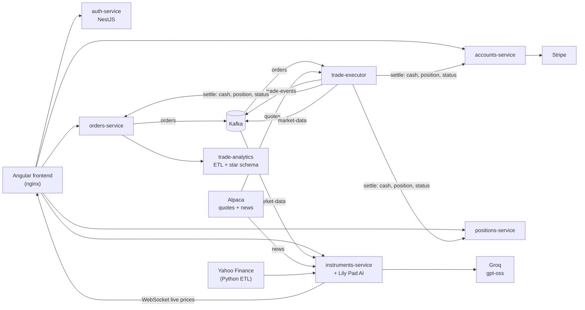
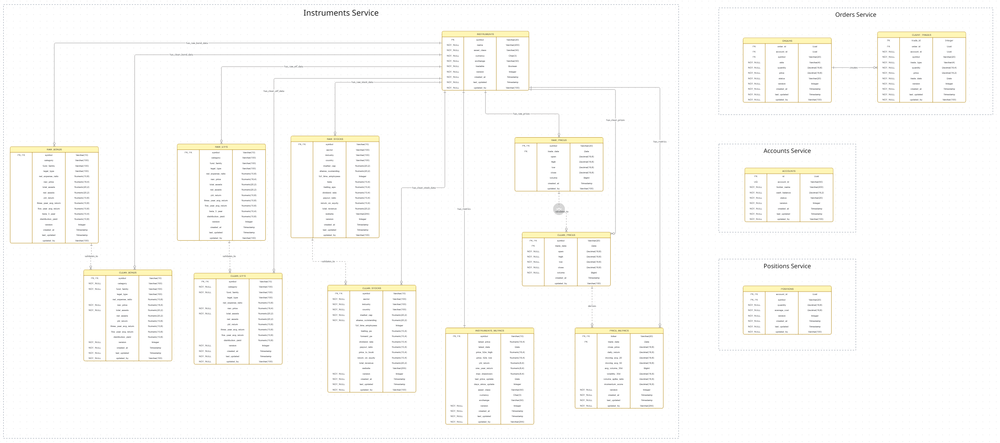

# UnderFrogs Trade 🐸

An enterprise trading platform built by **The UnderFrogs** as an applied capstone project.

**Objective:** move trade and market data reliably and securely across many services, the way real financial firms do.

**Solution:** a distributed, event-driven application with a secure and accessible interface. Users sign up, fund their account through Stripe, trade stocks, ETFs and bond funds at live prices, track their portfolios, and ask **Lily Pad**, an AI research assistant whose every figure is checked against our own data.

## Contents
- [Team and links](#team-and-links)
- [Features](#features)
- [Architecture](#architecture)
- [Tech stack](#tech-stack)
- [Getting started](#getting-started)
- [Using the platform](#using-the-platform)
- [Lily Pad AI assistant](#lily-pad-ai-assistant)
- [Data integrity and consistency](#data-integrity-and-consistency)
- [Monitoring](#monitoring)
- [Testing](#testing)
- [CI/CD and quality gates](#cicd-and-quality-gates)
- [Local security scans](#local-security-scans)
- [Branching strategy (GitFlow)](#branching-strategy-gitflow)
- [Troubleshooting](#troubleshooting)
- [Further documentation](#further-documentation)

## Team and links

| Name |
|---|
| Marco Nocerino |
| David Jayakumar |
| Shane Ginty |
| Jamie Montgomery |

- [Jira board](https://underfrog.atlassian.net/?continue=https%3A%2F%2Funderfrog.atlassian.net%2Fwelcome%2Fsoftware%3FprojectId%3D10000&atlOrigin=eyJpIjoiNGY4NzRlNDY5N2I4NDUwYmI3NDFjYjY2ZGUyYWRmMDUiLCJwIjoiamlyYS1zb2Z0d2FyZSJ9)
- [Example UI](https://claude.ai/artifact/MGcqvq2Sjnbi1U1FVrFH8N#page-dcb81aee8d83)

## Features

| Feature | What it does |
|---|---|
| **Secure sign-in** | Register and log in through auth-service. Short-lived RS256 tokens, refresh tokens, and the option to change your profile and password and sign out other sessions |
| **Live prices** | Alpaca quotes stream to the browser over a WebSocket: dashboard, portfolio and the login page ticker |
| **Trading** | Buy and sell stocks, ETFs and bond funds with a price limit. Orders are filled by the trade executor and settle through Kafka |
| **Portfolios** | Group holdings into named portfolios (for example Growth and Income), each with a risk level and benchmark. Live P&L, daily change and allocation |
| **Instrument pages** | Line or Japanese candlestick charts with moving averages, today's candle updated live, and the latest news for that instrument |
| **News** | Source-linked market news from Alpaca, in the footer and on each instrument page |
| **Wallet** | Top up your account with **Stripe Checkout**. Each payment is credited exactly once |
| **Lily Pad AI assistant** | Ask about news, price moves, trends, fundamentals and comparisons. Every figure is checked against our data. [More below](#lily-pad-ai-assistant) |
| **Analytics** | A Python Dash dashboard (live prices, ticker analysis, screener) and a trade analytics star schema loaded by a scheduled ETL |
| **Monitoring** | Prometheus metrics from every service, with Grafana for dashboards |
| **Accessibility** | Keyboard navigation, screen-reader labels, light and dark mode, and support for the "reduce motion" setting |

## Architecture



- **Microservices with a database each.** Every service owns its own Postgres database, and no service reads another's.
- **Event-driven.** Services talk through Kafka:

  | Topic | Key | Carries |
  |---|---|---|
  | `orders` | `accountId` | `ORDER_PLACED` |
  | `trade-events` | `accountId` | `ORDER_FILLED`, `ORDER_REJECTED`, `ORDER_CANCELLED` |
  | `market-data` | `symbol` | `PRICE_UPDATED` |

  Each has a matching `.DLT` dead-letter topic. See [kafka-topics.md](app/docs/kafka-topics.md).
- **One identity provider.** Only auth-service issues tokens (RS256). The other services check them with its public key at `/.well-known/jwks.json`. The trade executor gets its own `SERVICE` token through client credentials.
- **Settlement saga.** A trade changes three databases, so the trade executor settles it in steps, and reverses earlier steps if a later one fails. See [settlement-saga.md](app/docs/settlement-saga.md).



## Tech stack

| Area | Technology |
|---|---|
| Frontend | Angular 22, Angular Material, Chart.js (ng2-charts), served by nginx |
| Backend services | Java 21, Spring Boot 3, Spring Data JPA (MyBatis in instruments-service) |
| Authentication | NestJS, RS256 JWTs, argon2id password hashing |
| Messaging | Apache Kafka 3.9 (KRaft), kafka-ui |
| Data | PostgreSQL 15, one database per service |
| Data pipeline and analytics | Python, yfinance, Dash, a trade analytics star schema |
| External APIs | Alpaca (quotes and news), Stripe (checkout), Groq (AI) |
| Monitoring | Prometheus, Grafana, nginx exporter |
| Quality | JUnit, Jest, Vitest, Playwright, pytest, JaCoCo, SonarQube, SpotBugs, OWASP Dependency-Check, Gitleaks |
| Delivery | Docker Compose, Jenkins |

## Getting started

### Prerequisites
- Docker with the standalone `docker-compose` command (v2)
- JDK 21 and Maven (the setup script builds the Java jars on your machine)
- Bash and `openssl` (on Windows, use WSL or Git Bash)

You don't need Node or Python locally to run the platform: auth-service, the frontend and the ETL are built inside Docker. You need Node 24 only to run the frontend or auth-service tests on your machine.

### 1) Create the `.env` files
Each service reads its own `app/<service>/.env`. These files are gitignored and **must never be committed**. This creates them from the `.env.example` files, with one generated database password shared by all of them:
```bash
PASSWORD=$(openssl rand -hex 16)
for s in accounts-service auth-service instruments-service orders-service positions-service trade-executor trade-analytics-service; do
  if [ ! -f app/$s/.env ]; then
    cp app/$s/.env.example app/$s/.env
    sed -i.bak "s|ENTER_PASSWORD_HERE|$PASSWORD|g" app/$s/.env && rm app/$s/.env.bak
  fi
done
```
It skips any service that already has a `.env`. If some already exist, copy their password into the new ones by hand.

You don't need to create any signing keys or service secrets. The setup script generates auth-service's RS256 key and the trade executor's client secret the first time it runs.

### 2) Add your own API keys (optional)
Everything runs without these. Each one switches on a feature:

| Feature | File | Variables | Without it |
|---|---|---|---|
| Live prices and filling at live quotes | `app/trade-executor/.env` | `ALPACA_KEY_ID` (starts with `PK`), `ALPACA_SECRET_KEY` from a free [Alpaca](https://alpaca.markets) paper account | Orders are priced from the daily close, at any time |
| News | `app/instruments-service/.env` | The same Alpaca keys | No news |
| Stripe top-ups | `app/accounts-service/.env` | `STRIPE_SECRET_KEY` (a **test mode** key, `sk_test_…`) and `FRONTEND_URL` | The wallet can't take payments |
| Lily Pad AI assistant | `app/instruments-service/.env` | `AI_API_KEY` from a free [Groq](https://console.groq.com) account | The assistant says it's unavailable |

With Alpaca keys set, the trade executor **only fills orders while the US market is open**. Leave them blank for demos outside market hours.

### 3) Run the setup script
From the repo root:
```bash
./db/scripts/setup-pipeline.sh
```
It:
1. checks the prerequisites, and creates the auth signing key and the trade executor's client secret if they're missing;
2. builds the Java jars;
3. stops anything already running and starts every container;
4. creates the tables;
5. loads instruments and price history from Yahoo Finance through the Python ETL;
6. seeds the users, accounts, orders, positions and the **demo trader's history**;
7. checks that the trade history matches the positions, then starts the analytics ETL;
8. prints row counts, Kafka topics and container status.

When it ends with `✓ Setup stage 'all' completed successfully!`, the platform is ready.

To run part of it, pass a stage: `build`, `containers`, `tables` or `populate` (see `--help`).

After editing a `.env`, recreate that container so it picks up the change. A plain `restart` doesn't reload `.env` files:
```bash
docker-compose up -d --force-recreate <service>
```

### 4) Open the app
Go to **http://localhost:8089** and sign in as the demo trader:

| Username | Password |
|---|---|
| `demo` | `Demo123!` |

The demo account has three portfolios (Main, Growth and Income), 11 holdings, six months of trades, a rejected, a cancelled and an open order, and two Stripe top-ups. To reset it, for example before recording a demo, run:
```bash
./db/scripts/load-demo-data.sh
```
This replaces only the demo account's orders, trades, positions and cash movements.

### Ports

| Service | URL or port |
|---|---|
| **Frontend** (Angular, nginx) | http://localhost:8089 |
| accounts-service | 8081 |
| instruments-service | 8082 |
| orders-service | 8083 |
| positions-service | 8084 |
| Python dashboard | http://localhost:8085 |
| kafka-ui | http://localhost:8086 |
| auth-service | 8087 |
| SonarQube (`quality` profile only) | http://localhost:8088 |
| Grafana | http://localhost:8080 |
| Prometheus | http://localhost:9090 |
| Kafka (external listener) | 127.0.0.1:9094 |
| accounts / instruments / orders / positions / analytics / auth databases | 127.0.0.1:5433–5438 |

### Environment variables

| Variable | Service | Purpose |
|---|---|---|
| `SPRING_DATASOURCE_URL`, `SPRING_DATASOURCE_USERNAME`, `SPRING_DATASOURCE_PASSWORD` | Java services | Their own database |
| `AUTH_JWKS_URI`, `AUTH_ISSUER`, `AUTH_AUDIENCE` | accounts, instruments, orders, positions | Where to fetch auth-service's public keys, and the `iss` / `aud` every token must carry. Optional; the defaults match docker-compose |
| `JWT_PRIVATE_KEY`, `JWT_KEY_ID` | auth-service | RS256 signing key. Generated by the setup script ([generate-signing-key.sh](app/auth-service/scripts/generate-signing-key.sh)) |
| `HTTPS_ENABLED` | auth-service | `true` adds HTTPS-only security headers. Leave unset while served over plain http, or browsers can't load Swagger |
| `AUTH_TOKEN_URL`, `AUTH_CLIENT_ID`, `AUTH_CLIENT_SECRET` | trade-executor | Client credentials for its `SERVICE` token. Written by the setup script |
| `KAFKA_BOOTSTRAP_SERVERS` | orders-service, trade-executor, instruments-service | Kafka broker, `kafka:9092` inside compose |
| `ALPACA_KEY_ID`, `ALPACA_SECRET_KEY` | trade-executor, instruments-service | Alpaca paper keys. Blank means daily close prices and no news |
| `ALPACA_TRADING_URL`, `MARKET_DATA_POLL_INTERVAL_MS` | trade-executor | Alpaca market clock, and how often quotes are polled for `market-data` |
| `STRIPE_SECRET_KEY`, `FRONTEND_URL` | accounts-service | Stripe Checkout for top-ups, and where Stripe sends the user back |
| `AI_API_KEY` | instruments-service | Groq key for Lily Pad. Blank means the assistant is unavailable |
| `AI_BASE_URL`, `AI_MODEL`, `AI_FALLBACK_MODEL` | instruments-service | AI provider (any OpenAI-compatible API) and models. Defaults: Groq, `openai/gpt-oss-120b`, falling back to `openai/gpt-oss-20b` |
| `AI_QUESTIONS_PER_MINUTE`, `AI_NEWS_CACHE_SECONDS` | instruments-service | Questions per user per minute (default 5) and how long news is reused (default 300s) |
| `ETL_INTERVAL_SECONDS` | trade-analytics-service | How often the analytics ETL runs |
| `GRAFANA_ADMIN_USER`, `GRAFANA_ADMIN_PASSWORD` | grafana (shell environment) | Grafana login. Defaults to `admin` / `admin` |

### Tear down
```bash
docker-compose down
docker-compose down --volumes
```
The second command also **wipes every database**.

## Using the platform

### In the app
1. Sign in at http://localhost:8089, as `demo` or a new account (**Register**).
2. **Dashboard:** portfolio value, cash, P&L, allocation and performance, with live prices.
3. **Instrument page:** search for a symbol in the top bar. Switch between line and candlestick charts, and read its news.
4. **Place an order:** **Place order** on the dashboard or the Orders page. A notification shows when it fills or is rejected.
5. **Portfolios:** create portfolios and move holdings between them.
6. **Wallet:** the account menu → **Wallet** → top up through Stripe. In test mode, use card `4242 4242 4242 4242` with any future date and CVC.
7. **Lily Pad:** the lily pad button in the bottom-right corner.

### Through the APIs
Every service except auth-service needs a token on each request (`Authorization: Bearer <accessToken>`). Tokens last 15 minutes; log in again if you start getting `401`.

**In Swagger**
1. Open auth-service at http://localhost:8087/docs and call `POST /auth/login`, or `POST /auth/register` for a new user (passwords need at least 12 characters):
   ```json
   {"username": "jane", "email": "jane@example.com", "password": "correct-horse-battery", "full_name": "Jane Doe"}
   ```
2. Copy the `accessToken`.
3. Open a service's Swagger page, click **Authorize**, paste the token and call any endpoint:

| Service | Swagger |
|---|---|
| accounts-service | http://localhost:8081/api/swagger-ui/index.html |
| instruments-service | http://localhost:8082/api/swagger-ui/index.html |
| orders-service | http://localhost:8083/api/swagger-ui/index.html |
| positions-service | http://localhost:8084/api/swagger-ui/index.html |

**With curl**
```bash
TOKEN=$(curl -s -X POST localhost:8087/auth/login -H 'Content-Type: application/json' \
  -d '{"username":"demo","password":"Demo123!"}' | python3 -c 'import sys,json; print(json.load(sys.stdin)["accessToken"])')
curl -H "Authorization: Bearer $TOKEN" localhost:8083/api/orders/account/ACC0011
```

### Watch the events
Open kafka-ui at http://localhost:8086, or follow a topic from the terminal:
```bash
docker exec kafka /opt/kafka/bin/kafka-console-consumer.sh --bootstrap-server localhost:9092 --topic trade-events --from-beginning
```

## Lily Pad AI assistant

Lily Pad answers questions about **market data only**: news, why a price moved, recent trends, fundamentals, comparisons of up to three symbols, and investing terms. It's built into instruments-service (`POST /api/assistant/chat`) and the frontend.

**How an answer is produced:**
1. The user picks a topic (News, Explain a move, Recent trends, Fundamentals, Compare, Learn a term) or types a question.
2. The model (Groq's open-weight, Apache 2.0 `gpt-oss`) can't reach any data itself. It asks for **read-only tools**: `resolve_ticker`, `get_price_change`, `get_news`, `get_trend` and `get_fundamentals`.
3. instruments-service runs each tool against our own data (Alpaca quotes and news, Yahoo prices and fundamentals) and works out all the figures in Java.
4. The model writes the answer from those results.
5. **Every figure and link in the answer is checked against the tool data.** If the check fails, the model gets one correction. If it fails again, the user sees the raw data instead.
6. The answer shows its **sources with timestamps**, a "checked against our data" badge and a fixed "not financial advice" disclaimer.

**Safeguards:**
- **No customer data.** It has no tools for portfolios, orders or cash, so none is ever sent to the AI provider. Nothing can be bought or sold through it.
- **People only.** Signed-in users only; service tokens are refused.
- **Limits.** 5 questions per user per minute; questions up to 500 characters.
- **No advice.** It won't give buy, sell or hold recommendations, and treats text inside news as data, not instructions.
- **Safe display.** Answers are shown as text and formatting only, never as HTML.

See the [chat sequence diagram](app/docs/diagrams/assistant-chat-sequence-uml.md).

## Data integrity and consistency

| Risk | How we handle it |
|---|---|
| A trade half-completes across three databases | The **settlement saga** settles in steps and reverses earlier steps if a later one fails |
| A retry charges or credits twice | **Unique keys:** an idempotency key per order, and one cash or position movement per (order, type). Stripe top-ups are keyed by payment ID |
| Events processed out of order | Kafka topics **keyed by account**, so each account's events stay in order |
| A bad message blocks the rest | Retries, then a **dead-letter topic** for review |
| Invalid data | **Database constraints** (positive quantities and prices, allowed statuses) and validated event envelopes |
| Two updates overwrite each other | **Optimistic locking** with a `version` column |
| Rounding errors | Money is stored and calculated as **exact decimals** (`NUMERIC` / `BigDecimal`) |
| Bad or stale quotes | `QuoteValidator` rejects missing prices, a bid above the ask, and old quotes. Newer quotes always win |
| Analytics loaded twice or missed | A **watermark** on the ETL, and a dead-letter table for rows that fail |
| AI makes up a number | Every figure is **checked against the data** before it's shown |

## Monitoring

- **Prometheus** (http://localhost:9090) scrapes the Spring Boot services' `/actuator/prometheus` endpoints, auth-service, and the frontend's nginx through `nginx-exporter`. Config: [monitoring/prometheus/prometheus.yml](monitoring/prometheus/prometheus.yml).
- **Grafana** (http://localhost:8080) comes with Prometheus already set up as a data source. Sign in with `admin` / `admin` unless you've set `GRAFANA_ADMIN_USER` and `GRAFANA_ADMIN_PASSWORD`.

## Testing

| What | Command | Needs the stack running? |
|---|---|---|
| Java service unit tests and coverage | `mvn -B -f app/<service>/pom.xml test` (coverage report in `target/site/jacoco/index.html`) | No |
| auth-service | `cd app/auth-service && npm ci && npm test` | No |
| Frontend unit tests | `cd app/frontend && npm ci && npx ng test --watch=false` | No |
| Frontend lint | `cd app/frontend && npx ng lint` | No |
| ETL and data tests | `docker-compose run --rm --no-deps python python -m pytest /db/tests` | No |
| Analytics ETL tests | `docker-compose run --rm --no-deps -v "$PWD/app/trade-analytics-service/tests:/app/tests" trade-analytics-service python -m pytest tests` | No |
| Playwright end-to-end | `cd app/frontend && npx playwright test` | Yes |
| Full smoke test | `./scripts/smoke-test-e2e.sh` | Starts its own |

- **Playwright:** `buy.spec.ts` and `sell.spec.ts` place **real orders** for the demo account. Run `./db/scripts/load-demo-data.sh` afterwards to reset it. The assistant test mocks the AI, so it doesn't use your Groq allowance.
- **Smoke test:** it builds and starts the stack, registers a user, places a BUY, checks the fill, cash, position and `ORDER_FILLED` event, then tears everything down. Set `KEEP_UP=true` to leave the stack running.

## CI/CD and quality gates

The [Jenkinsfile](Jenkinsfile) builds and tests every service in parallel, runs the auth-service, frontend and Python tests, runs the end-to-end smoke test, scans dependencies, and runs a SonarQube analysis and quality gate for each Java service. A failing gate stops the pipeline.

### SonarQube quality gate

Jenkins analyses the five Java services as separate SonarQube projects and waits for each quality gate. JaCoCo XML reports from the unit-test stage are imported by the matching Sonar analysis.

To run SonarQube locally without starting it with the rest of the stack:
```bash
docker-compose --profile quality up -d sonarqube
```
Open http://localhost:8088, complete the first-run setup, create an analysis token, and use the **Sonar way** gate, or a project gate with these conditions on new code:
- Blocker issues greater than 0: fail.
- Critical issues greater than 0: fail.
- Security hotspots reviewed below 100%: fail.
- Coverage below 80%: fail.
- Duplicated lines above 3%: fail.

A security hotspot is a prompt for human review, not automatically a vulnerability.

**Jenkins setup:** configure **Manage Jenkins → System → SonarQube installations** with installation name `SonarQube`, the server URL, and a **Secret text** credential holding the token. The pipeline uses `withSonarQubeEnv('SonarQube')`. Add a SonarQube webhook to `<JENKINS_URL>/sonarqube-webhook/`; `waitForQualityGate` needs it to receive the result.

To analyse a service locally, test it first so JaCoCo writes its report, then pass the host and token as environment variables (never commit the token):
```bash
export SONAR_HOST_URL=http://localhost:8088
export SONAR_TOKEN='<your SonarQube token>'
mvn -B -f app/accounts-service/pom.xml clean verify sonar:sonar \
  -Dsonar.host.url="$SONAR_HOST_URL" -Dsonar.token="$SONAR_TOKEN" \
  -Dsonar.projectKey=theunderfrogs-accounts-service
```
Repeat with the matching POM and key: `theunderfrogs-instruments-service`, `theunderfrogs-orders-service`, `theunderfrogs-positions-service` and `theunderfrogs-trade-executor`.

## Local security scans

Run these before opening a PR. Keep the reports outside the repository and attach sanitised copies to the PR. Fix every high and critical finding, or record a specific, justified "won't fix". Dependency-Check uses the NVD API, so set `NVD_API_KEY` to a personal key to avoid slow updates and rate limits.

### SAST: SpotBugs with FindSecBugs
Writes findings to each service's `target/spotbugsXml.xml`:
```bash
for service in accounts-service instruments-service orders-service positions-service trade-executor; do
  mvn -B -f "app/$service/pom.xml" clean verify \
    com.github.spotbugs:spotbugs-maven-plugin:4.10.3.0:spotbugs
done
```

### Dependency scanning: OWASP Dependency-Check
Writes HTML, JSON and SARIF reports for each service to `/tmp/underfrogs-security-reports`:
```bash
mkdir -p /tmp/underfrogs-security-reports
for service in accounts-service instruments-service orders-service positions-service trade-executor; do
  mvn -B -f "app/$service/pom.xml" \
    org.owasp:dependency-check-maven:12.2.2:check \
    -Dformat=ALL \
    -DnvdApiKey="${NVD_API_KEY:-}" \
    -Dodc.outputDirectory="/tmp/underfrogs-security-reports/$service"
done
```

### Secret detection: Gitleaks over history and working tree
The history scan covers all local refs; the directory scan checks current, uncommitted files. Gitleaks redacts secrets in its output:
```bash
docker run --rm -v "$PWD:/repo:ro" -v "/tmp/underfrogs-security-reports:/reports" \
  zricethezav/gitleaks:v8.30.1 git --config=/repo/.gitleaks.toml \
  --log-opts="--all" \
  --report-format sarif --report-path=/reports/gitleaks-history.sarif \
  --redact=100 /repo

mkdir -p /tmp/underfrogs-gitleaks-tree /tmp/underfrogs-security-reports
git ls-files -co --exclude-standard -z \
  | tar --null -T - -cf - \
  | tar -xf - -C /tmp/underfrogs-gitleaks-tree
docker run --rm -v "/tmp/underfrogs-gitleaks-tree:/repo:ro" \
  -v "/tmp/underfrogs-security-reports:/reports" \
  zricethezav/gitleaks:v8.30.1 dir --config=/repo/.gitleaks.toml \
  --report-format sarif --report-path=/reports/gitleaks-working-tree.sarif \
  --redact=100 /repo
```
A secret found in Git history must be treated as exposed: rotate it, remove it from current files, and agree any history rewrite with the repository owners.

### Reviewed scan findings
- **`SPRING_CSRF_PROTECTION_DISABLED`** (SpotBugs, 2026-09-30), in accounts, instruments, orders and positions. These are stateless APIs that authenticate with bearer JWTs, not browser cookies or sessions, so CSRF protection is intentionally off. Recorded as a justified exception. The trade executor had no priority-1 finding.
- **`CRLF_INJECTION_LOGS`** in `InstrumentService.deleteInstrument`. Fixed: the user-controlled symbol is no longer logged, and the follow-up scan is clean.
- **Gitleaks `generic-api-key`** at `OrderControllerMvcIntegrationTest.java:127`. It's the `idempotencyKey` of a test request, not a credential. `.gitleaks.toml` allows only that path and line; review it if that test changes.

## Branching strategy (GitFlow)

| Branch | Purpose |
|---|---|
| `main` | Production-ready code only. Every commit should be deployable |
| `develop` | Integration branch for finished features. The default branch for ongoing work |
| `feature/<short-description>` | Created from `develop` for each feature or fix |

**Workflow:**
1. Create a feature branch from `develop`. Keep commits focused, and merge `develop` in regularly.
2. Open a pull request into `develop`.
3. At least **one approved review** before merging. No direct pushes to `main`. Resolve all comments first.
4. Squash-merge, then delete the feature branch.

## Troubleshooting

| Problem | Fix |
|---|---|
| `Schema-validation: missing table` | The database was created from an older schema. Run `docker-compose down --volumes`, then the setup script again |
| `401` on every request | The token wasn't issued by auth-service, has expired, or its `iss` / `aud` doesn't match `AUTH_ISSUER` / `AUTH_AUDIENCE`. Log in again. If the services can't reach `AUTH_JWKS_URI`, every token is rejected |
| Database password errors after changing `.env` | Postgres keeps the password it was created with. Change it back, or wipe the volumes |
| `docker: 'compose' is not a docker command` | Use `docker-compose`, with the hyphen |
| Orders stay `NEW` | With Alpaca keys set, orders only fill while the US market is open. Remove the keys to fill from the daily close |
| No news, or the assistant says it's unavailable | Add the Alpaca keys or `AI_API_KEY` to `app/instruments-service/.env`, then `docker-compose up -d --force-recreate instruments-service` |
| The assistant returns `429` | Each user can ask 5 questions a minute. Wait a moment |
| The demo account looks wrong after tests | Run `./db/scripts/load-demo-data.sh` |
| Running out of disk space | `docker builder prune -f` and `docker image prune -a -f` free several GB without touching your data |

## Further documentation

| Document | What it covers |
|---|---|
| [kafka-topics.md](app/docs/kafka-topics.md) | Topics, keys, partitions, retention and dead-letter handling |
| [settlement-saga.md](app/docs/settlement-saga.md) | How a trade settles across three services |
| [event-envelope.schema.json](app/docs/event-envelope.schema.json) | The shared Kafka message format |
| [diagrams/](app/docs/diagrams) | Domain, order, sell, persistence, idempotent writes, failure handling and AI chat sequence diagrams |
| [fact-trades-star-schema.md](app/trade-analytics-service/docs/fact-trades-star-schema.md) | The analytics star schema |
| [auth-service README](app/auth-service/README.md) | Authentication endpoints and token details |
| Swagger and OpenAPI | Each service's Swagger UI (see [Through the APIs](#through-the-apis)) and the YAML files in `app/<service>/docs/` |
