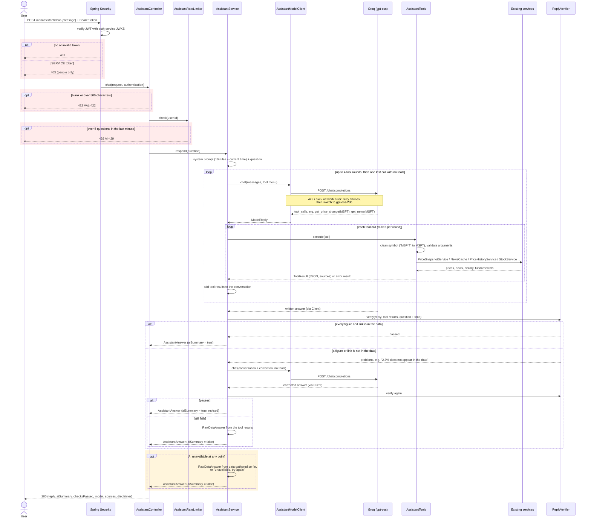

# AI Assistant Chat – UML Sequence Diagram

Traced from `AssistantController.chat` in instruments-service for one question, e.g.
"Why is Microsoft down today?". The AI never reads data itself: it asks for tools, and
`AssistantTools` calls the existing services. Every reply is checked against the tool data
before the user sees it.

## Notes

- **The AI cannot reach any data on its own.** It only sees the text it is sent. It asks for a tool by
  name, and `AssistantTools` decides whether the request is valid and which existing service to call.
- **All tools are read-only.** There is no tool that places orders or reads portfolios, orders or cash.
- **The maths is done in Java** (`BigDecimal`), so the AI only quotes numbers. `ReplyVerifier` checks that
  every quoted figure appears in the tool data, allowing for honest rounding.
- **The disclaimer is added by the controller,** not the AI, so it is always present.
- **Not covered yet:** an audit log of each answer, and earnings reports (planned with SEC EDGAR).
