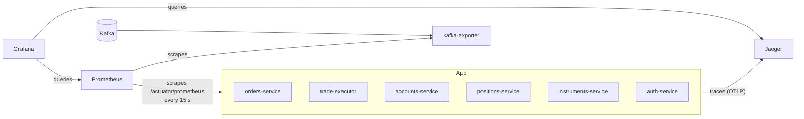

# Observability

> **Status:** Proposal. Nothing in this document is built yet.

Dashboards, alerts and tracing that show how our services are doing and **exactly what happens to a trade as it moves through every service**. It is built with OpenTelemetry, Prometheus, Grafana and Jaeger, all running in Docker Compose next to the existing stack.

## Summary

- **What it is:** a Grafana dashboard of system health (traffic, latency, errors, memory, Kafka lag), an alert when a service goes down, and a trace view that follows one trade from orders-service through Kafka to trade-executor and back.
- **Why it's useful:** when a trade fails or is slow, we can see which service caused it instead of searching through logs in six containers.
- **How much code it needs:** very little. Tracing uses the OpenTelemetry Java agent, which needs **no code changes**. Metrics need one dependency and some config per service. Most of the work is Docker Compose and Grafana setup.
- **Cost:** one person, 5 days, about 1.2 GB of extra memory on the server.
- **Showcase moment:** place a trade in the app, then open its trace and follow it end to end.

## Team decisions

| Question | Proposal (to confirm) |
|---|---|
| Who owns it? | One person, separate from the AI assistant owner. |
| Which tracing backend? | **Jaeger** (one container, simplest). Tempo is an alternative but needs more setup. |
| Do we collect logs centrally (Loki)? | Not in the first version. Logs carry trace IDs, and we search them with `docker logs`. Loki is future work. |
| Do we trace the Angular frontend? | No. Traces start at the backend (see [Known limitations](#7-known-limitations)). |

---

## 1. What it shows

### Metrics dashboard (Grafana)

| Panel | What it tells us | Source |
|---|---|---|
| **Service status** | Which services are up or down right now | Prometheus `up` metric |
| **Request rate** | Requests per second for each service and route | Spring Boot / Micrometer HTTP metrics |
| **Latency (p50 / p95)** | How long requests take, and which routes are slow | Micrometer HTTP metrics |
| **Error rate** | Percentage of 4xx and 5xx responses per service | Micrometer HTTP metrics |
| **JVM memory and GC** | Heap use against our 512 MB container limits | Micrometer JVM metrics |
| **Database connections** | Hikari pool use (our pools are capped at 5) | Micrometer Hikari metrics |
| **Kafka consumer lag** | How far trade-executor and orders-service are behind on `orders`, `trade-events` and `market-data` | kafka-exporter |
| **Dead-letter messages** | Messages arriving on `orders.DLT`, `trade-events.DLT` and `market-data.DLT` | kafka-exporter topic offsets |

### Alerts

| Alert | Fires when |
|---|---|
| **Service down** | A service's metrics endpoint has been unreachable for 1 minute |
| **High error rate** | More than 5% of a service's requests return 5xx for 5 minutes |
| **Consumer falling behind** | Kafka lag on `orders` or `trade-events` stays above 100 messages for 5 minutes |
| **Dead-letter message** | Any new message lands on a `.DLT` topic |

Alerts are shown in Grafana's alert list. Email or Slack notifications are future work.

### Traces (Jaeger)

Placing a trade produces one trace covering every service it touches. We expect it to look roughly like this (the exact spans depend on the code):

```
POST /api/orders                                orders-service
├── INSERT orders                               orders-service → orders-db
├── publish orders                              orders-service → Kafka
└── process orders                              trade-executor (Kafka consumer)
    ├── GET /api/instruments/{symbol}           → instruments-service
    ├── POST /api/accounts/{id}/debit           → accounts-service
    ├── POST /api/positions/{id}/{symbol}/buy   → positions-service
    └── publish trade-events                    trade-executor → Kafka
        └── process trade-events                orders-service (Kafka consumer)
            └── UPDATE orders                   orders-service → orders-db
```

Each step shows how long it took and whether it failed. A failed or slow trade shows exactly which step went wrong.

### Logs linked to traces

Every log line written during a request includes its `trace_id`. From a trace in Jaeger, we copy the ID and find every related log line across all services:

```bash
docker compose logs orders-service trade-executor accounts-service positions-service | grep <trace_id>
```

---

## 2. How it is implemented

### Architecture



- **Metrics:** each service exposes a `/actuator/prometheus` endpoint. Prometheus reads (scrapes) it every 15 seconds.
- **Traces:** the OpenTelemetry agent in each service sends traces directly to Jaeger over OTLP. We skip the OpenTelemetry Collector to save memory. It can be added later if needed.
- **Dashboards and alerts:** Grafana reads from Prometheus and Jaeger. Its data sources, dashboards and alert rules are loaded from files in the repo, so everything appears on `docker compose up` with no manual setup.

### Tracing: the OpenTelemetry Java agent (no code changes)

The agent is a jar that attaches when the JVM starts. It automatically traces incoming and outgoing HTTP, JDBC queries and **Kafka producers and consumers**. It also carries the trace ID inside Kafka message headers, which is what lets one trace follow a trade across the `orders` and `trade-events` topics.

1. **Add the agent to each Java Dockerfile**, pinned to an exact release:
   ```dockerfile
   ADD https://github.com/open-telemetry/opentelemetry-java-instrumentation/releases/download/v<pinned-version>/opentelemetry-javaagent.jar /otel/opentelemetry-javaagent.jar
   ```
2. **Turn it on in `docker-compose.yml`.** All Java services already share the `x-java-env` block, so the agent is added once:
   ```yaml
   x-java-env: &java-env
     JAVA_TOOL_OPTIONS: >-
       -XX:MaxRAMPercentage=70
       -XX:MaxMetaspaceSize=192m
       -XX:+ExitOnOutOfMemoryError
       -javaagent:/otel/opentelemetry-javaagent.jar
     SPRING_DATASOURCE_HIKARI_MAXIMUM_POOL_SIZE: 5
     OTEL_EXPORTER_OTLP_ENDPOINT: http://jaeger:4318
     OTEL_EXPORTER_OTLP_PROTOCOL: http/protobuf
     OTEL_METRICS_EXPORTER: none      # metrics come from Micrometer instead
     OTEL_LOGS_EXPORTER: none         # logs stay in docker logs
   ```
   Then give each service its own name:
   ```yaml
   orders-service:
     environment:
       <<: *java-env
       OTEL_SERVICE_NAME: orders-service
   ```
3. **Make trades easy to find (small code change).** In orders-service, tag the span with the order ID when an order is created:
   ```java
   Span.current().setAttribute("order.id", order.getOrderId());
   ```
   In Jaeger we can then search by `order.id=<id>` to open a specific trade's trace.

**auth-service (NestJS)** uses `@opentelemetry/sdk-node` with `@opentelemetry/auto-instrumentations-node`, loaded before the app starts. **The Python dashboard** uses `opentelemetry-instrument`. Both send to the same Jaeger endpoint. These come after the Java services, since the trade flow is entirely in Java.

### Metrics: Actuator and Micrometer

For each Spring Boot service (accounts, instruments, orders, positions, trade-executor):

1. Add dependencies (trade-executor already has Actuator):
   ```xml
   <dependency>
       <groupId>org.springframework.boot</groupId>
       <artifactId>spring-boot-starter-actuator</artifactId>
   </dependency>
   <dependency>
       <groupId>io.micrometer</groupId>
       <artifactId>micrometer-registry-prometheus</artifactId>
   </dependency>
   ```
2. Expose only what Prometheus needs:
   ```yaml
   management:
     endpoints.web.exposure.include: health,prometheus
     metrics.distribution.percentiles-histogram.http.server.requests: true   # enables p95 latency
     metrics.tags.application: ${spring.application.name}
   ```
3. **Allow Prometheus through Spring Security.** Every service's `SecurityConfig` has `anyRequest().authenticated()`, so Prometheus would get a 401. Add:
   ```java
   .requestMatchers(EndpointRequest.to("health", "prometheus")).permitAll()
   ```
   See [section 3](#3-security) for why this is acceptable.

**auth-service** exposes `/metrics` with `prom-client`. **Kafka lag** comes from a `kafka-exporter` container, with no changes to Kafka itself.

### Logs with trace IDs

The OpenTelemetry agent automatically adds `trace_id` and `span_id` to each service's logging context (MDC).

- **orders-service** already writes JSON logs with `LogstashEncoder` (the `json-logs` profile), which includes MDC fields by default. It gets trace IDs with no extra work.
- **Other Java services:** copy orders-service's `logback-spring.xml` and the `json-logs` profile, or add `%X{trace_id}` to their log pattern.

### New containers

```yaml
  prometheus:
    image: prom/prometheus:<pinned-version>
    container_name: prometheus
    mem_limit: 384m
    volumes:
      - ./monitoring/prometheus/prometheus.yml:/etc/prometheus/prometheus.yml:ro
      - prometheus_data:/prometheus
    command:
      - --config.file=/etc/prometheus/prometheus.yml
      - --storage.tsdb.retention.time=3d
    ports:
      - "127.0.0.1:9090:9090"

  grafana:
    image: grafana/grafana:<pinned-version>
    container_name: grafana
    mem_limit: 256m
    env_file: ./monitoring/grafana/.env          # GF_SECURITY_ADMIN_PASSWORD, gitignored
    environment:
      GF_AUTH_ANONYMOUS_ENABLED: "false"
    volumes:
      - ./monitoring/grafana/provisioning:/etc/grafana/provisioning:ro
      - ./monitoring/grafana/dashboards:/var/lib/grafana/dashboards:ro
      - grafana_data:/var/lib/grafana
    depends_on: [prometheus, jaeger]
    ports:
      - "127.0.0.1:3000:3000"

  jaeger:
    image: jaegertracing/all-in-one:<pinned-version>
    container_name: jaeger
    mem_limit: 512m
    environment:
      MEMORY_MAX_TRACES: "20000"                 # in-memory storage, capped
    ports:
      - "127.0.0.1:16686:16686"                  # Jaeger UI only; OTLP stays on the Docker network

  kafka-exporter:
    image: danielqsj/kafka-exporter:<pinned-version>
    container_name: kafka-exporter
    mem_limit: 64m
    command: ["--kafka.server=kafka:9092"]
    depends_on:
      kafka:
        condition: service_healthy
```

Add `prometheus_data:` and `grafana_data:` under the top-level `volumes:`.

### Repo layout

```
monitoring/
├── prometheus/
│   └── prometheus.yml                 # scrape targets: each service + kafka-exporter
└── grafana/
    ├── .env.example                   # GF_SECURITY_ADMIN_PASSWORD
    ├── provisioning/
    │   ├── datasources/datasources.yml   # Prometheus + Jaeger
    │   ├── dashboards/dashboards.yml     # loads JSON from /var/lib/grafana/dashboards
    │   └── alerting/alerts.yml           # the four alert rules
    └── dashboards/
        ├── system-overview.json       # our own: status, traffic, latency, errors, Kafka
        ├── jvm.json                   # community "JVM (Micrometer)" dashboard
        └── kafka.json                 # community "Kafka Exporter Overview" dashboard
```

The two community dashboards come from grafana.com and are saved as JSON so they load automatically. `system-overview.json` is built in the Grafana UI, then exported and committed.

### Access

| Tool | URL | Login |
|---|---|---|
| Grafana | http://localhost:3000 | `admin` / password from `monitoring/grafana/.env` |
| Jaeger | http://localhost:16686 | none (only reachable from the server itself) |
| Prometheus | http://localhost:9090 | none (only reachable from the server itself) |

---

## 3. Security

Observability tools can expose internal data if set up carelessly. The design keeps them private:

| # | Concern | How it is handled |
|---|---|---|
| 1 | **Dashboards reachable from outside** | Grafana, Jaeger and Prometheus ports are bound to `127.0.0.1`, like our databases. From another machine, use an SSH tunnel. |
| 2 | **Default Grafana password** | The admin password comes from a gitignored `.env`, and anonymous access is turned off. |
| 3 | **Metrics endpoints without a login** | Only `health` and `prometheus` are exposed. They contain counts and timings, not user data. The services are only reachable through the Docker network and our published ports, as today. |
| 4 | **Sensitive data in traces** | The agent records URLs, status codes and timings by default, **not** request bodies or headers, so JWTs and passwords are not captured. Keep it that way: don't turn on header or body capture. JDBC query parameters are masked by default. |
| 5 | **Account IDs in traces** | URLs such as `/api/accounts/{id}` appear in span names. Account IDs are internal identifiers, not personal data, and Jaeger is private to the server. |
| 6 | **Traces kept forever** | Jaeger keeps traces in memory only (capped at 20,000) and loses them on restart. Prometheus keeps 3 days of metrics. |

---

## 4. Memory budget

The server has 16 GB of RAM. The new containers have memory limits so they can't starve the app:

| Container | Limit |
|---|---|
| Prometheus | 384 MB |
| Grafana | 256 MB |
| Jaeger | 512 MB |
| kafka-exporter | 64 MB |
| **Total** | **about 1.2 GB** |

The existing stack's limits add up to about 6.4 GB (SonarQube is in the `quality` profile, so it doesn't run by default). With the AI assistant's Ollama container (up to 6 GB), the total is about 13.6 GB of 16 GB. That fits, but tightly. If memory runs short during the demo, switch the assistant to OpenAI.

The OpenTelemetry agent also adds roughly 50–100 MB per JVM and slows startup by a few seconds. Our Java containers are limited to 512 MB, so check heap use on the JVM dashboard after turning it on, and raise `start_period` in the health checks if services are marked unhealthy while starting.

---

## 5. Testing and checks

| Check | Expected result |
|---|---|
| Open Prometheus → Status → Targets | Every service and kafka-exporter shows **UP** |
| Open the Grafana system overview | All panels show data. No "No data" panels. |
| Place a trade in the app, then search Jaeger by `order.id` | One trace covering orders-service, Kafka, trade-executor, accounts-service and positions-service |
| A rejected trade (for example, insufficient funds) | The trace shows which step failed, marked as an error |
| `grep` the trace ID in `docker compose logs` | Log lines from each service in that trade |
| `docker compose stop positions-service` | "Service down" alert fires within about 1 minute |
| Send a malformed message to `orders` | "Dead-letter message" alert fires once it lands on `orders.DLT` |
| Search Jaeger spans for `Authorization` or `password` | Nothing found |

---

## 6. Delivery plan (5 days, one owner)

| Day | Work |
|---|---|
| 1 | Prometheus and Grafana in compose. Actuator, Micrometer and the security rule on all Java services. All Prometheus targets showing UP. |
| 2 | OpenTelemetry agent in the Java Dockerfiles and `x-java-env`. Jaeger. The `order.id` span attribute. A trade's trace showing end to end. |
| 3 | kafka-exporter, the system overview dashboard, the community dashboards, the four alert rules. |
| 4 | Trace IDs in logs for all Java services. auth-service and the Python dashboard instrumented. Run the checks in section 5. |
| 5 | Fixes, docs and demo rehearsal: place a trade and follow its trace live. |

If time runs short, cut auth-service and Python instrumentation (day 4) before cutting the trade trace or the dashboard.

---

## 7. Known limitations

| Limitation | What it means | How we reduce it |
|---|---|---|
| **No browser tracing** | Traces start when a request reaches the backend, so time spent in Angular isn't shown. | The demo still works: place an order, open its trace. Browser tracing is future work. |
| **Logs aren't centralised** | Finding logs for a trace means running `docker compose logs` and `grep`, not clicking from Jaeger. | Trace IDs are in every log line. Loki is future work. |
| **Traces are lost on restart** | Jaeger stores traces in memory. | Fine for a demo and debugging. Persistent storage is future work. |
| **Tight memory with Ollama** | The full stack plus Ollama plus monitoring uses most of the 16 GB. | Memory limits on every container. Switch the assistant to OpenAI if needed. |
| **Trace shape not yet confirmed** | The trace in [section 1](#traces-jaeger) is what we expect from the Kafka topics and service calls, not something we have seen yet. | Confirmed on day 2. Update this doc with a real screenshot. |
| **Python ETL isn't traced** | The analytics ETL runs as a scheduled batch job, so a request trace doesn't fit it. | Only the Python dashboard is instrumented. |

---

## 8. Working with the AI assistant

If the [AI assistant](ai-assistant.md) is built, it gets the same instrumentation:
- **Tracing:** one question appears as one trace, showing each tool call to positions-service or instruments-service and how long the model took.
- **Metrics:** questions per minute, answer time and tool-call failures on the dashboard.
- **A combined demo:** ask the assistant about a trade, then open the trace to show which routes it called, as the user, with nothing else.

---

## 9. Future work

- **Loki** for central logs, with a "view logs" link from each trace in Grafana.
- **Business metrics:** orders placed, filled and rejected per minute (a few Micrometer counters in orders-service and trade-executor).
- **Alert notifications** to email or Slack.
- **Browser tracing** in Angular with the OpenTelemetry web SDK.
- **OpenTelemetry Collector** between the services and Jaeger, for sampling and sending to more than one backend.
